<div align="center">


# ∑ Advanced Math Lab — Calculator

**A scientific calculator, function grapher and math toolkit in one offline app.** Type expressions freely, graph `y = f(x)` with pan, zoom and trace, get symbolic derivatives with steps, and solve integrals, limits, equations, geometry and unit conversions. 🧮📈

[](https://jaineil32624.github.io/CALCULATOR/)
[](https://github.com/jaineil32624/CALCULATOR/releases/latest/download/MathLab.apk)
[](https://github.com/jaineil32624/CALCULATOR/releases/latest)


-EF4444)


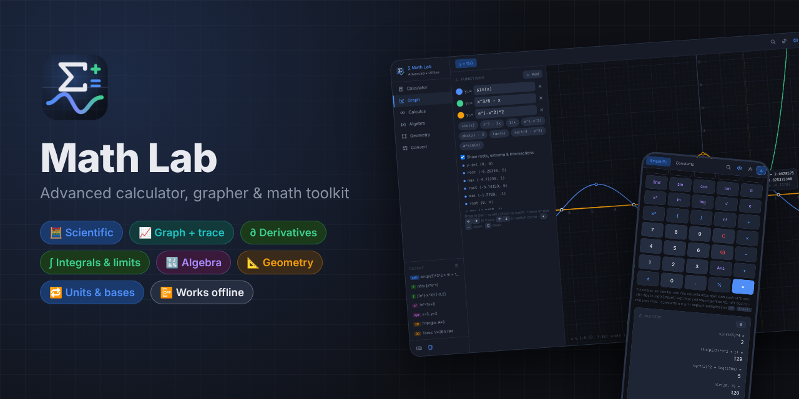

</div>

---

## ✨ Features

| | Feature | What it does |
|---|---|---|
| ⌨️ | **Type anywhere** | Full keyboard input: just start typing. `Enter` evaluates, `Esc` clears, `↑`/`↓` browse history, and after a result an operator keeps going from `Ans` |
| 🧮 | **Scientific keypad** | sin/cos/tan + inverses (**2nd**), hyperbolics, ln/log/log base b, √ ∛, n!, nCr/nPr, gamma, mod, gcd/lcm, π e φ τ, implicit multiplication like `2π` and `3(4+1)` |
| 💾 | **Memory keys** | MC · MR · M+ · M− · MS, with a memory badge on the display |
| 🕘 | **Saved history** | Your last 100 calculations stay on your device. Click an expression to reuse it, or click an answer to insert it |
| 📐 | **DEG / RAD** | One tap (or `Alt+R`) switches the angle mode |
| ½ | **Fractions** | `a/b` shows results such as `0.75` as `3/4` |
| 📈 | **Grapher** | Up to 6 functions. Drag to pan, scroll or pinch to zoom, and trace by hover, tap or arrow keys to see x, y and slope. Roots, extrema and intersections are found for you, an animated `a` parameter slider is built in, and you can save the graph as a PNG |
| ∂ | **Symbolic derivatives** | Real differentiation (product, quotient, chain, trig, log, exponential rules) with simplification, 1st to 3rd order, steps, tangent line and a mini plot |
| ∫ | **Integrals & limits** | Adaptive Simpson integration with shaded area. Limits from either side or at `±inf`, with a table of approach values |
| 🔣 | **Algebra** | Linear equations, 2×2 and 3×3 systems (Cramer), quadratics (roots, factored form, vertex, graph), a polynomial expander and all roots, complex ones included |
| 📏 | **Geometry** | 9 2D shapes with live results and a diagram (triangle angles and type, regular n-gon) plus 9 3D solids, including a torus |
| 🔁 | **Converters** | 11 unit categories (length, mass, temperature, data, energy and more) plus DEC/HEX/OCT/BIN with tap-to-flip bits |
| 🔎 | **Command palette** | `Ctrl+K` searches every tool and setting |
| 🔗 | **Share links** | Copy a link that reopens and re-runs exactly what you're looking at |
| 🌗 | **Light / dark** | Both themes, saved on your device |
| 🔊 | **Feedback** | Ripple key presses, optional synth click sounds (Web Audio) and vibration on phones |
| 🛡️ | **Safe by design** | A hand-written tokenizer and Pratt parser (`engine.js`). User input never goes through `eval()` or `new Function()` |

## 📸 Screenshots

<table>
<tr>
<td>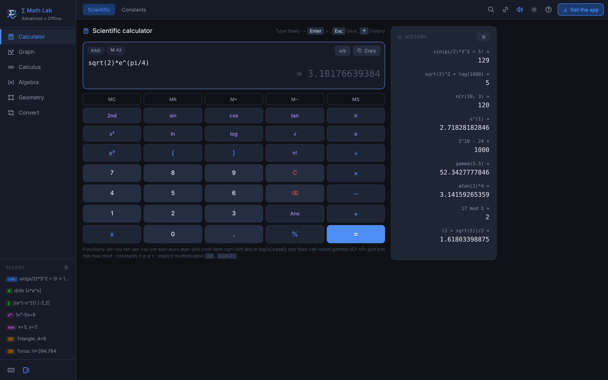<p align="center">🧮 <b>Scientific calculator</b> with history & memory</p></td>
<td>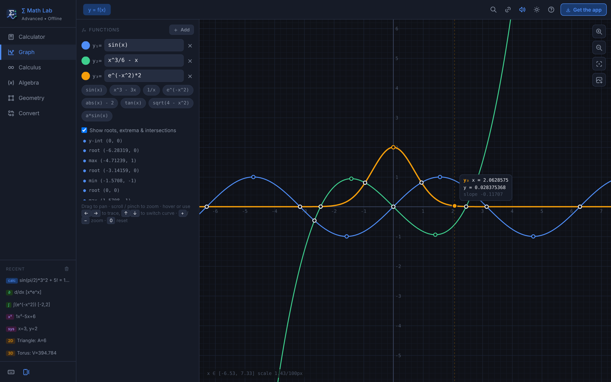<p align="center">📈 <b>Grapher</b>: trace, roots & intersections</p></td>
</tr>
<tr>
<td>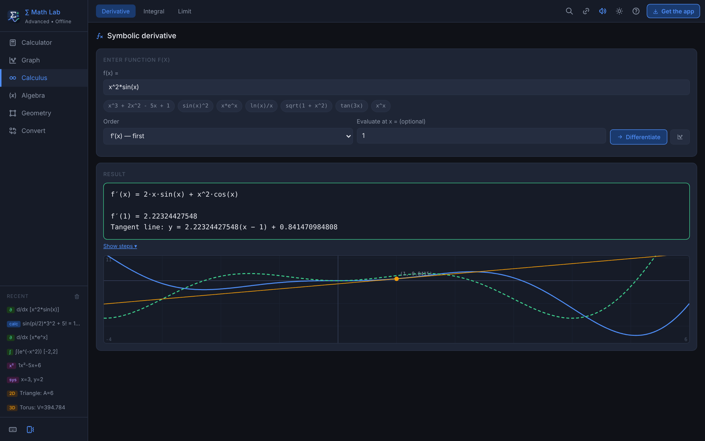<p align="center">∂ <b>Symbolic derivative</b> + tangent line</p></td>
<td>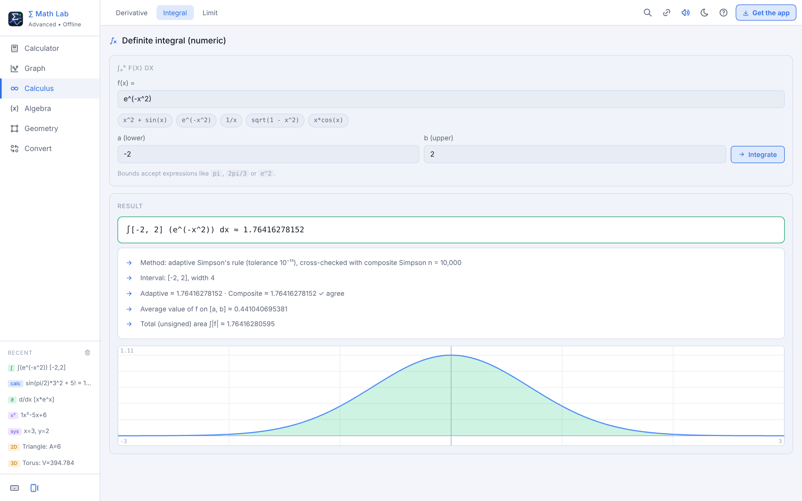<p align="center">∫ <b>Integral</b> with shaded area (light theme)</p></td>
</tr>
<tr>
<td>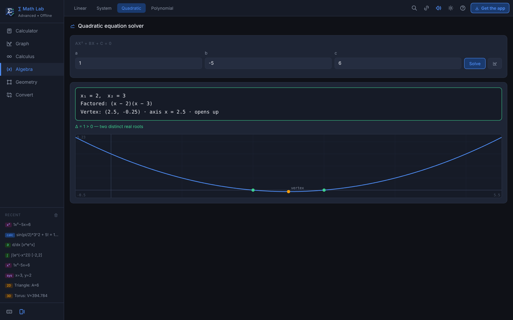<p align="center">🔣 <b>Quadratic</b>: roots, factored form, vertex</p></td>
<td>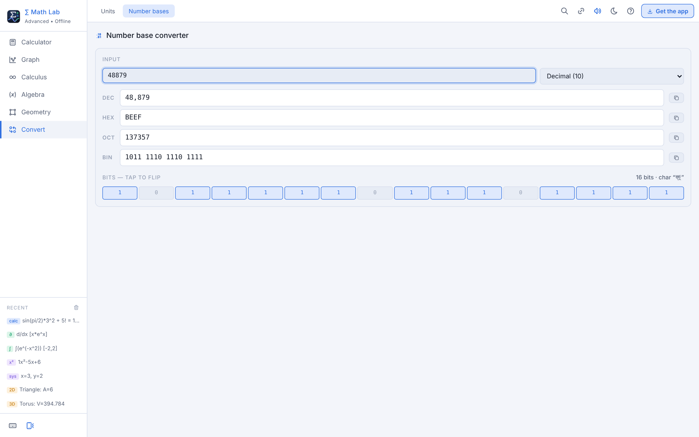<p align="center">🔁 <b>Number bases</b> with tap-to-flip bits</p></td>
</tr>
<tr>
<td>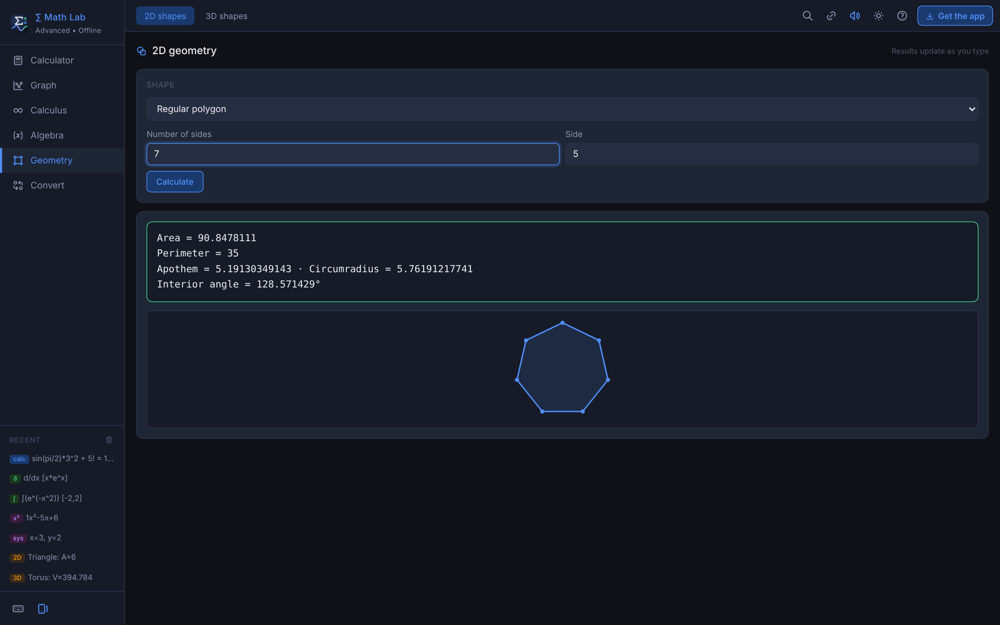<p align="center">📏 <b>Geometry</b> with live diagram</p></td>
<td>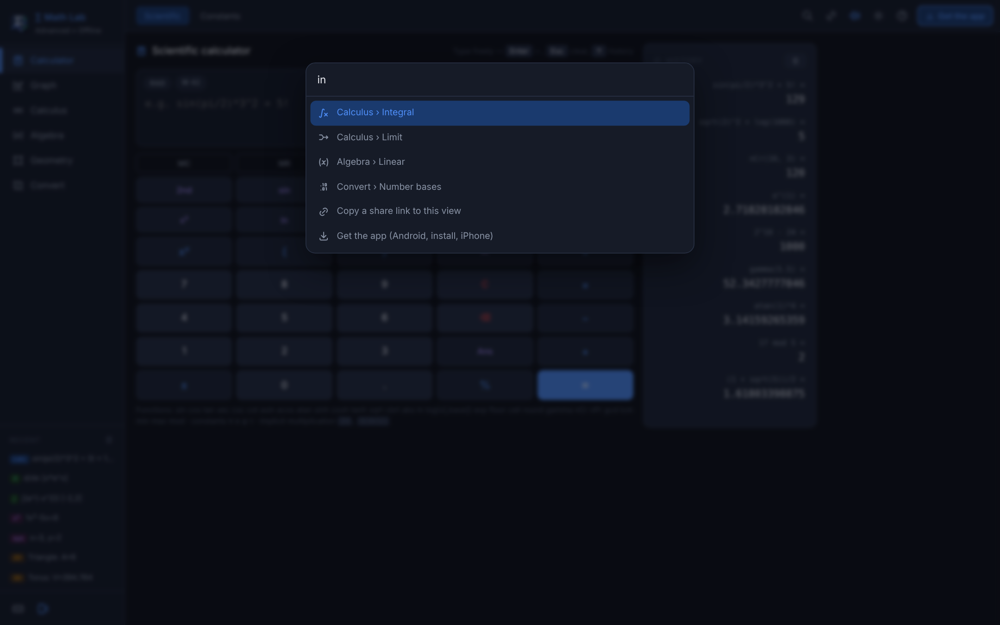<p align="center">🔎 <b>Ctrl+K</b> command palette</p></td>
</tr>
</table>

<p align="center">
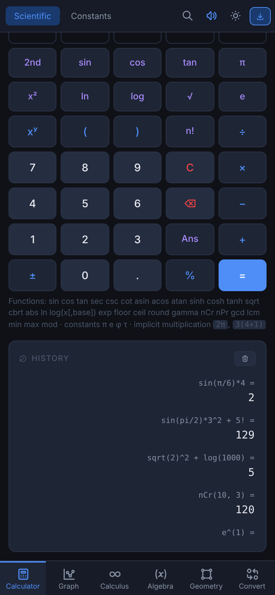
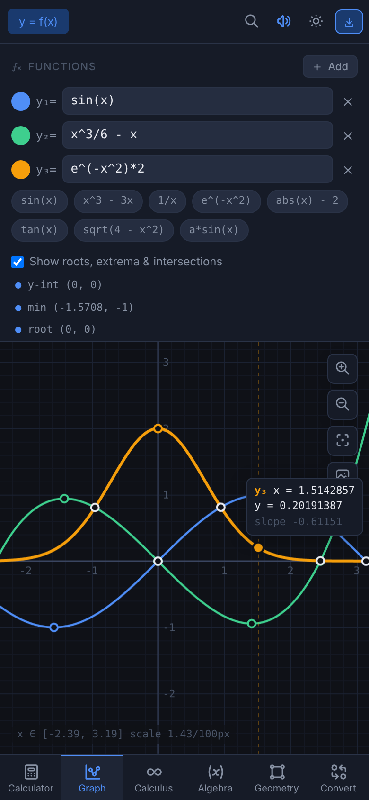
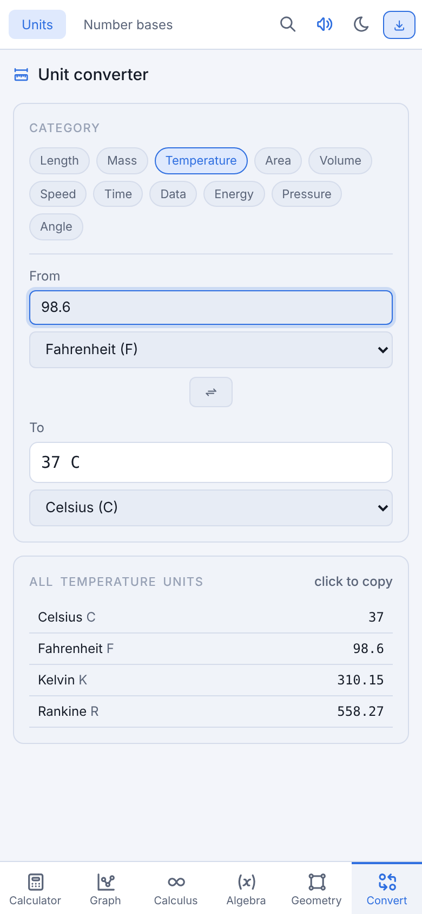
<br><em>📱 Made for phones: bottom navigation, big keys, pinch-zoom graphs</em>
</p>

## 📥 Get Math Lab

| Platform | How |
|---|---|
| 🌐 **Web** | Open **[jaineil32624.github.io/CALCULATOR](https://jaineil32624.github.io/CALCULATOR/)**. Nothing to install |
| 🤖 **Android** | Download **[MathLab.apk](https://github.com/jaineil32624/CALCULATOR/releases/latest/download/MathLab.apk)** → open it → allow *Install unknown apps* if asked |
| 💻 **Windows / Mac / Chromebook** | Open the website in Chrome or Edge → **⬇ Get the app** → **Install** |
| 🍎 **iPhone / iPad** | Open the website in Safari → **Share** → **Add to Home Screen** |
| 📦 **Offline zip** | Grab **MathLab-web.zip** from [Releases](https://github.com/jaineil32624/CALCULATOR/releases/latest), unzip it, open `index.html` |

> 💡 Works **100% offline** once installed. No account, no ads, no tracking. History, memory and graphs stay on your device.

<p align="center">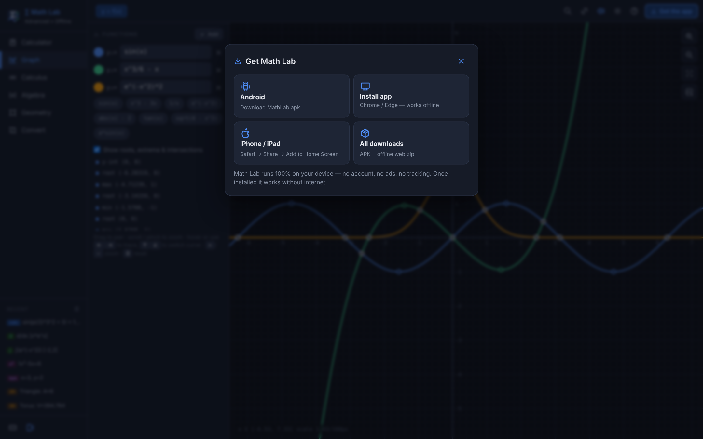</p>

## ⌨️ Shortcuts

`Ctrl+K` search · `Alt+1…6` modules · `[` `]` tabs · `Alt+D` theme · `Alt+M` sound · `Alt+R` DEG/RAD · `Alt+C` copy result · `?` help · graph: `+` `−` `0`, `←` `→` trace, `↑` `↓` switch curve

## 🛠️ Run it locally

```bash
git clone https://github.com/jaineil32624/CALCULATOR.git
cd CALCULATOR
python3 -m http.server 8000      # then open http://localhost:8000
```

No build step and no dependencies. Old links to `advanced_math_lab.html` redirect to `index.html` automatically.

## 🗂️ Project structure

```
CALCULATOR/
├── index.html              🧱 layout + styles
├── app.js                  🧠 UI: calculator, grapher, solvers, converters, overlays
├── engine.js               🛡️ safe parser, evaluator, symbolic derivative, polynomials
├── advanced_math_lab.html  ↪️ redirect for old links
├── sw.js                   📴 offline service worker
├── manifest.webmanifest    📲 installable-app manifest
├── icons/                  🖼️ app icons (SVG + PNG + maskable)
├── vendor/tabler/          🔣 Tabler icon font, bundled for offline use
├── docs/screenshots/       📸 images for this README
├── VERSION                 🏷️ bump to publish a new release
└── .github/workflows/
    ├── release.yml         🤖 builds the Android APK + publishes a Release
    └── vendor.yml          ⬇️ refreshes the offline icon font
```

## 🚀 Releasing a new version

Bump the number in `VERSION` and push. GitHub Actions builds the APK and publishes the release automatically:

```bash
echo "1.1.0" > VERSION
git commit -am "Release 1.1.0" && git push
```

---

<div align="center">

Made with 💙, ☕ and a lot of π by **[Jaineil Rana](https://github.com/jaineil32624)**

⭐ *If Math Lab helped with your homework, give it a star!* ⭐

</div>
